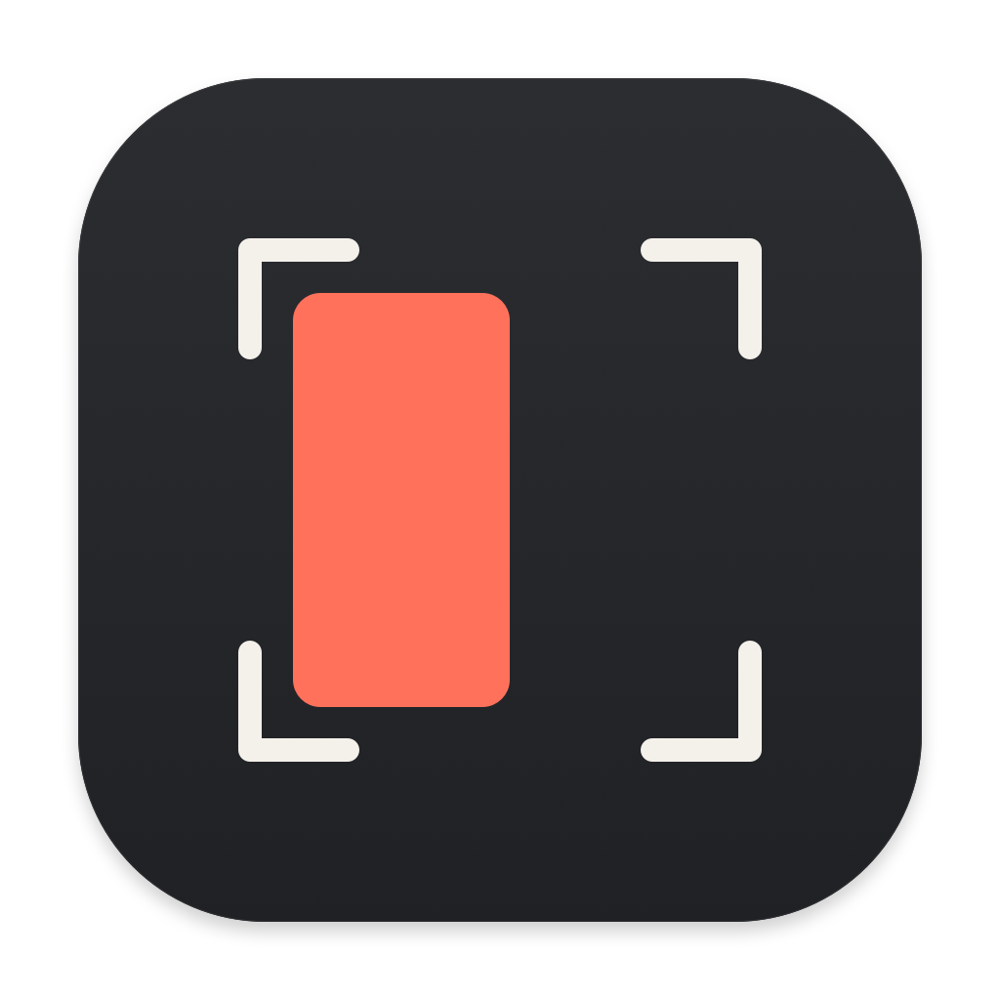

  
  <h1>Window Snapper</h1>
  
<strong>A shortcut. A snap. Back to work.</strong>

  
A small native macOS menu bar app for arranging windows.

  
Swift · Apple frameworks only · No third-party dependencies

  
<a href="https://github.com/kazuki0216/Window-Snapper/releases/download/v0.1.0-beta.1/Window-Snapper-0.1.0-arm64.zip"><strong>Download for Apple Silicon</strong></a> · <a href="https://github.com/kazuki0216/Window-Snapper/releases/tag/v0.1.0-beta.1">Release notes</a>

---

Snap to halves or quarters, maximize, center, restore, and move windows between displays—all from keyboard shortcuts or the menu bar.

## Quick start

1. Download and unzip the app, then drag **Window Snapper.app** into **Applications**.
2. Open it and grant **Accessibility** permission.
3. Focus a window and press **Control + Option + ←**.

No Swift, Xcode, Git, or Homebrew is needed to run the prebuilt app.

**Beta:** Apple Silicon only; declared minimum macOS 13. Not Apple-notarized, so macOS or workplace policy may block it. [Installation details](docs/installation.md).

## Documentation

| Guide | What you’ll find |
| --- | --- |
| [Installation](docs/installation.md) | Download, permissions, updates, removal, and troubleshooting |
| [Using Window Snapper](docs/usage.md) | Every shortcut, displays, preferences, and limitations |
| [Building from source](docs/building.md) | Developer tools, build commands, and editable icon artwork |
| [Packaging and releases](docs/releases.md) | Create an app ZIP and publish a download |
| [Security](SECURITY.md) | Permissions, data handling, signing, and workplace review |
| [Contributing](CONTRIBUTING.md) | Modifications, pull requests, and owner approval |
| [License](LICENSE) · [Disclaimer](DISCLAIMER.md) | Reuse permissions, warranties, and responsibility |

Voluntarily shared, free of charge, under the MIT License. Provided as is, without warranties, subject to applicable law.
